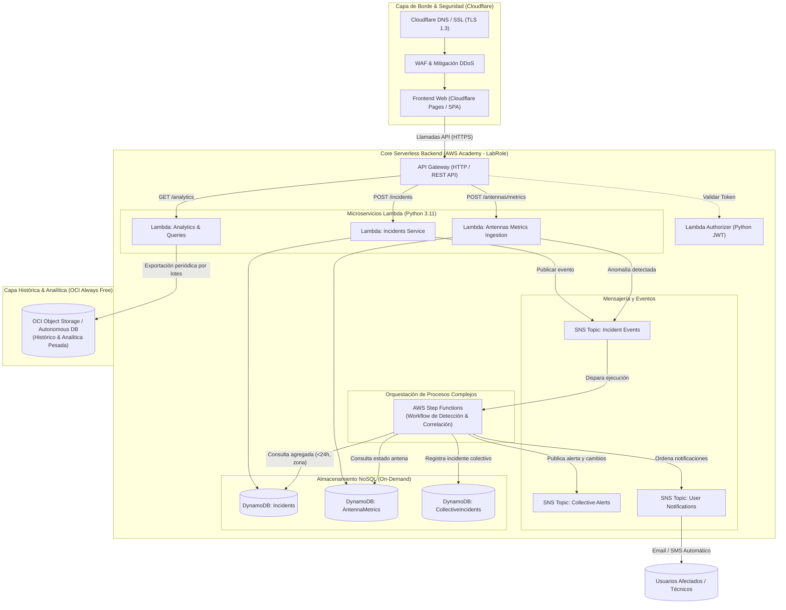
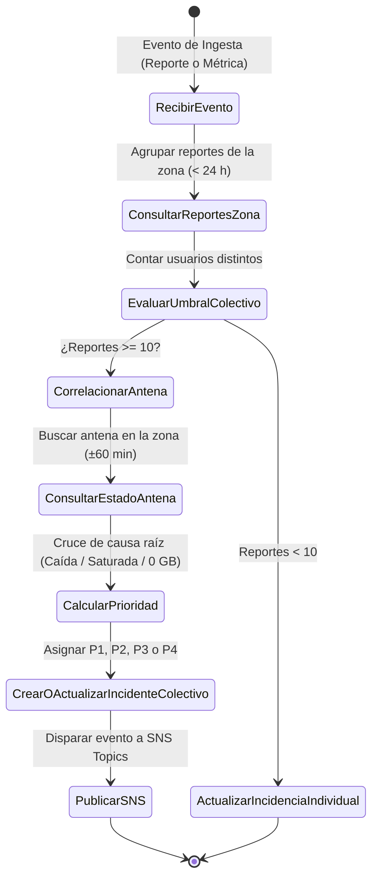

# Arquitectura Técnica del Sistema – Red TeleCorp
## Solución Serverless para Detección y Gestión Inteligente de Incidencias

Este documento define la arquitectura técnica del proyecto **Red TeleCorp**, adaptada específicamente a las capacidades, restricciones y presupuesto de un **Tier de Estudiantes (AWS Academy Learner Lab / Free Tier)**, junto con una distribución multicloud pragmática que incorpora **AWS**, **Oracle Cloud Infrastructure (OCI)** y **Cloudflare**.

---

## 1. Visión General de la Arquitectura

La plataforma sigue un paradigma **100% Serverless y Orientado a Eventos (Event-Driven Architecture)**, diseñado para:
1. **Costo Cero en Reposo:** Los servicios no generan costos cuando no hay tráfico de red ni reportes activos.
2. **Escalabilidad Elástica:** Absorción de picos repentinos de tráfico (tormentas de reportes ante cortes de fibra o fallas masivas de energía).
3. **Compatibilidad Estricta con AWS Academy:** Uso exclusivo del rol preexistente **`LabRole`** para eludir las restricciones de creación de roles IAM.
4. **Despliegue Automatizado:** Toda la infraestructura de backend se define mediante Infraestructura como Código (IaC) con **Serverless Framework (`serverless.yml`)**.



---

## 2. División de Responsabilidades entre Proveedores

| Proveedor | Servicios Utilizados | Responsabilidad | Justificación en Tier de Estudiantes |
| :--- | :--- | :--- | :--- |
| **Cloudflare** | DNS, SSL/TLS Universal, WAF, Pages / CDN | Proxy reverso seguro, mitigación DDoS, encriptación en tránsito y entrega de la aplicación frontend estática. | **100% Gratuito:** Elimina la necesidad de CloudFront y ACM en AWS, ahorrando complejidad y cuotas de red. |
| **AWS** | API Gateway, **Python Lambda**, **Amazon SNS**, **AWS Step Functions**, DynamoDB | Procesamiento serverless en tiempo real, autenticación JWT, evaluación de umbrales, correlación de red y disparo de notificaciones automáticas. | **AWS Academy Friendly:** Compatible con el límite de \$100 del Learner Lab mediante facturación por petición y rol `LabRole`. |
| **OCI (Oracle Cloud)** | OCI Object Storage / Autonomous Database | Almacenamiento a largo plazo de métricas históricas de antenas y reportes consolidados para análisis de recurrencia. | **Always Free Tier:** Almacenamiento gratuito vitalicio (hasta 20 GB Object Storage y 2 bases de datos autónomas), liberando espacio en AWS. |

---

## 3. Componentes Principales en AWS

### 3.1. Funciones Lambda en Python
- **Runtime:** `python3.11` o `python3.12` (optimizado para bajo tiempo de cold start y ligereza).
- **Dimensionamiento de Memoria:** `128 MB` a `256 MB` por función (suficiente para operaciones I/O y procesamiento JSON; minimiza el consumo de GB-segundos en AWS Academy).
- **Módulos funcionales:**
  1. `authorizer`: Validador stateless de tokens JWT con claims de usuario y rol.
  2. `incidents_handler`: Registro de reportes individuales y consulta de estado/historial.
  3. `metrics_handler`: Ingesta periódica de telemetría de tráfico por antena con clasificación de umbrales:
     - `0 GB/min`: Inhabilitada.
     - `< 60 GB/min`: Caída.
     - `60 - 129 GB/min`: Normal.
     - `> 129 GB/min`: Saturada.
  4. `detector_evaluator`: Lógica auxiliar invocada por Step Functions para consultas de ventanas de tiempo y cálculo de prioridad.

### 3.2. Orquestación con AWS Step Functions
El flujo de evaluación de incidentes colectivos requiere coordinar consultas a la base de datos, cruce de información temporal, asignación de prioridades y distribución de eventos. Step Functions proporciona una máquina de estados visual, tolerante a fallos y sin servidores activos.



**Ventajas en el Tier de Estudiantes:**
- En el Free Tier de AWS se incluyen 4,000 transiciones de estado gratuitas al mes.
- Elimina la necesidad de tener un worker en segundo plano (como Celery o un contenedor EC2/ECS) corriendo permanentemente.

### 3.3. Amazon SNS (Simple Notification Service)
El patrón de mensajería **Pub/Sub** permite desacoplar los productores de eventos de los consumidores:
1. **`telecorp-incident-events`**: Recibe las altas de incidencias y métricas anómalas. Dispara la máquina de estados de Step Functions.
2. **`telecorp-collective-alerts`**: Emite alertas operativas inmediatas para técnicos y personal de soporte ante incidentes colectivos o fallas recurrentes.
3. **`telecorp-user-notifications`**: Canal automático de salida que despacha correos (vía suscripciones de Email en SNS) o SMS a los números telefónicos registrados en las incidencias.

---

## 4. Configuración Crítica de Permisos e IAM: `LabRole`

> [!IMPORTANT]
> **Restricción de AWS Academy Learner Lab:**
> Los usuarios de cuentas estudiantiles en AWS Academy **no tienen permisos** para ejecutar `iam:CreateRole`, `iam:CreatePolicy` ni `iam:AttachRolePolicy`.
> Si se intenta desplegar un archivo `serverless.yml` estándar, el despliegue fallará con el error:
> `User is not authorized to perform: iam:CreateRole on resource`.

### Solución Arquitectónica
En AWS Academy, todas las funciones Lambda, Step Functions y recursos deben asumir el rol preexistente del laboratorio denominado **`LabRole`**.

En el archivo `serverless.yml`, se debe asignar de forma centralizada a nivel de `provider`:

```yaml
provider:
  name: aws
  runtime: python3.11
  region: us-east-1
  iam:
    role: arn:aws:iam::${aws:accountId}:role/LabRole
```

De este modo:
- Serverless Framework **no intentará crear nuevos roles IAM**.
- Todas las funciones Lambda y máquinas de estados utilizarán el rol `LabRole`, el cual ya cuenta con permisos completos de ejecución sobre CloudWatch Logs, DynamoDB, SNS, Step Functions, S3 y API Gateway.

---

## 5. Modelo de Datos Serverless (Amazon DynamoDB)

Se utilizan tablas con modo de facturación **On-Demand (`PAY_PER_REQUEST`)**, lo que garantiza \$0 de costo cuando no hay lecturas ni escrituras.

### 5.1. Tabla `telecorp-incidents`
- **Partition Key (PK):** `zone_id` (String, ej. `"ZONA-SUR-01"` o Geohash)
- **Sort Key (SK):** `incident_id` (String, ej. `"INC#20261115-00142"`)
- **Atributos:** `user_id`, `phone`, `email`, `problem_type`, `description`, `status` (`REGISTRADA`, `EN_REVISION`, `ATENDIDA`, `SOLUCIONADA`, `CERRADA`), `collective_id` (opcional), `created_at`, `updated_at`.
- **GSI1 (Búsqueda por Usuario):** `PK: user_id`, `SK: created_at`

### 5.2. Tabla `telecorp-antennas-metrics`
- **Partition Key (PK):** `antenna_id` (String, ej. `"ANT-402"`)
- **Sort Key (SK):** `timestamp` (String, ISO-8601)
- **Atributos:** `zone_id`, `traffic_gb_min` (Number), `status` (`NORMAL`, `CAIDA`, `SATURADA`, `INHABILITADA`).

### 5.3. Tabla `telecorp-collective-events`
- **Partition Key (PK):** `zone_id` (String)
- **Sort Key (SK):** `collective_id` (String, ej. `"COL#20261115-ZONA-SUR-01"`)
- **Atributos:** `affected_users_count`, `priority` (`P1`, `P2`, `P3`, `P4`), `related_antenna_id`, `antenna_status`, `state`, `created_at`, `updated_at`.

---

## 6. Infraestructura como Código: `serverless.yml`

A continuación se presenta la definición completa y optimizada para el backend en `back/aws/serverless.yml`:

```yaml
service: telecorp-backend

frameworkVersion: '3'

provider:
  name: aws
  runtime: python3.11
  region: ${opt:region, 'us-east-1'}
  stage: ${opt:stage, 'dev'}
  # Obligatorio para AWS Academy Learner Lab:
  iam:
    role: arn:aws:iam::${aws:accountId}:role/LabRole
  environment:
    STAGE: ${self:provider.stage}
    INCIDENTS_TABLE: telecorp-incidents-${self:provider.stage}
    METRICS_TABLE: telecorp-antennas-metrics-${self:provider.stage}
    COLLECTIVE_TABLE: telecorp-collective-events-${self:provider.stage}
    INCIDENTS_SNS_TOPIC_ARN: !Ref IncidentEventsTopic
    NOTIFICATIONS_SNS_TOPIC_ARN: !Ref UserNotificationsTopic
    JWT_SECRET: ${env:JWT_SECRET, 'TelecorpSecretKey2026Jwt'}

plugins:
  - serverless-step-functions

functions:
  # ==========================================
  # 1. Autorizador JWT
  # ==========================================
  jwtAuthorizer:
    handler: src/auth/authorizer.handler

  # ==========================================
  # 2. Servicios de Incidencias de Usuarios
  # ==========================================
  createIncident:
    handler: src/incidents/create.handler
    events:
      - http:
          path: /incidents
          method: post
          cors: true
          authorizer:
            name: jwtAuthorizer
            resultTtlInSeconds: 300
            identitySource: method.request.header.Authorization

  getIncidentsByUser:
    handler: src/incidents/get_by_user.handler
    events:
      - http:
          path: /incidents/my-reports
          method: get
          cors: true
          authorizer:
            name: jwtAuthorizer

  updateIncidentStatus:
    handler: src/incidents/update_status.handler
    events:
      - http:
          path: /incidents/{id}/status
          method: patch
          cors: true
          authorizer:
            name: jwtAuthorizer

  # ==========================================
  # 3. Ingesta de Métricas de Antenas
  # ==========================================
  ingestAntennaMetrics:
    handler: src/antennas/ingest.handler
    events:
      - http:
          path: /antennas/metrics
          method: post
          cors: true

  # ==========================================
  # 4. Workers de Notificación y Evaluación
  # ==========================================
  notificationWorker:
    handler: src/notifications/worker.handler
    events:
      - sns:
          arn: !Ref UserNotificationsTopic
          topicName: telecorp-user-notifications-${self:provider.stage}

  evaluateIncidentGroup:
    handler: src/analytics/evaluate_group.handler

stepFunctions:
  stateMachines:
    incidentCorrelationFlow:
      name: telecorp-incident-correlation-${self:provider.stage}
      definition:
        Comment: "Orquestación de Detección Colectiva, Correlación de Antenas y Notificaciones"
        StartAt: CheckZoneReports
        States:
          CheckZoneReports:
            Type: Task
            Resource:
              Fn::GetAtt: [evaluateIncidentGroup, Arn]
            Next: IsCollectiveThresholdReached

          IsCollectiveThresholdReached:
            Type: Choice
            Choices:
              - Variable: "$.isCollective"
                BooleanEquals: true
                Next: CorrelateWithAntenna
            Default: EndFlow

          CorrelateWithAntenna:
            Type: Task
            Resource:
              Fn::GetAtt: [evaluateIncidentGroup, Arn]
            Next: SendCollectiveNotification

          SendCollectiveNotification:
            Type: Task
            Resource: "arn:aws:states:::sns:publish"
            Parameters:
              TopicArn: !Ref UserNotificationsTopic
              Message:
                event: "COLLECTIVE_INCIDENT_DETECTED"
                zoneId.$: "$.zoneId"
                affectedUsers.$: "$.affectedUsersCount"
                priority.$: "$.priority"
                antennaStatus.$: "$.antennaStatus"
            End: true

          EndFlow:
            Type: Pass
            End: true

resources:
  Resources:
    # ------------------------------------------
    # Tablas DynamoDB (Facturación On-Demand $0 reposo)
    # ------------------------------------------
    IncidentsTable:
      Type: AWS::DynamoDB::Table
      Properties:
        TableName: telecorp-incidents-${self:provider.stage}
        BillingMode: PAY_PER_REQUEST
        AttributeDefinitions:
          - AttributeName: zone_id
            AttributeType: S
          - AttributeName: incident_id
            AttributeType: S
        KeySchema:
          - AttributeName: zone_id
            KeyType: HASH
          - AttributeName: incident_id
            KeyType: RANGE

    MetricsTable:
      Type: AWS::DynamoDB::Table
      Properties:
        TableName: telecorp-antennas-metrics-${self:provider.stage}
        BillingMode: PAY_PER_REQUEST
        AttributeDefinitions:
          - AttributeName: antenna_id
            AttributeType: S
          - AttributeName: timestamp
            AttributeType: S
        KeySchema:
          - AttributeName: antenna_id
            KeyType: HASH
          - AttributeName: timestamp
            KeyType: RANGE

    CollectiveEventsTable:
      Type: AWS::DynamoDB::Table
      Properties:
        TableName: telecorp-collective-events-${self:provider.stage}
        BillingMode: PAY_PER_REQUEST
        AttributeDefinitions:
          - AttributeName: zone_id
            AttributeType: S
          - AttributeName: collective_id
            AttributeType: S
        KeySchema:
          - AttributeName: zone_id
            KeyType: HASH
          - AttributeName: collective_id
            KeyType: RANGE

    # ------------------------------------------
    # Tópicos SNS
    # ------------------------------------------
    IncidentEventsTopic:
      Type: AWS::SNS::Topic
      Properties:
        TopicName: telecorp-incident-events-${self:provider.stage}

    UserNotificationsTopic:
      Type: AWS::SNS::Topic
      Properties:
        TopicName: telecorp-user-notifications-${self:provider.stage}
```

---

## 7. Estructura Sugerida del Repositorio

Para mantener una base de código limpia y modular:

```text
Telecorp/
├── ARCHITECTURE.md                  # Este documento de arquitectura técnica
├── ISSUE.md                         # Contexto del reto Red TeleCorp
├── SPECIFICATION.md                 # Requerimientos y reglas de negocio del sistema
├── front/                           # Aplicación cliente (React / Vite o HTML/JS)
│   └── (Alojada en Cloudflare Pages)
└── back/
    ├── aws/
    │   ├── serverless.yml           # IaC completo para AWS (usando LabRole)
    │   ├── package.json             # Dependencias de plugins serverless
    │   └── src/
    │       ├── auth/
    │       │   └── authorizer.py    # Validador de JWT Lambda Authorizer
    │       ├── incidents/
    │       │   ├── create.py        # Ingesta de incidencias de usuarios
    │       │   ├── get_by_user.py   # Consulta de reportes por usuario
    │       │   └── update_status.py # Cambio de estado e historial
    │       ├── antennas/
    │       │   └── ingest.py        # Clasificación de antenas (0, <60, >129 GB/min)
    │       ├── analytics/
    │       │   └── evaluate_group.py# Detección colectiva y correlación
    │       └── notifications/
    │           └── worker.py        # Procesador de notificaciones automáticas (SNS)
    └── oci/
        └── sync_history.py          # Script opcional de sincronización a OCI Always Free
```

---

## 8. Recomendaciones para Maximizar el Crédito de Estudiantes

1. **Sin Gateways NAT ni Balanceadores (ALB):** Se utiliza API Gateway nativo, el cual es 100% serverless y cobra únicamente por millón de peticiones.
2. **Retención de Logs en CloudWatch:** Configurar la retención de logs en 7 días para no acumular costo por almacenamiento de logs.
3. **Persistencia DynamoDB On-Demand:** Evita el aprovisionamiento de capacidad fija (Read/Write Capacity Units) que cobraría continuamente incluso con el sistema inactivo.
4. **Cloudflare como Capa de Caché Gratuita:** Al cachear peticiones estáticas y llamadas `GET` repetitivas en el Edge de Cloudflare, se reduce el número de ejecuciones Lambda y el consumo del presupuesto estudiantil.

